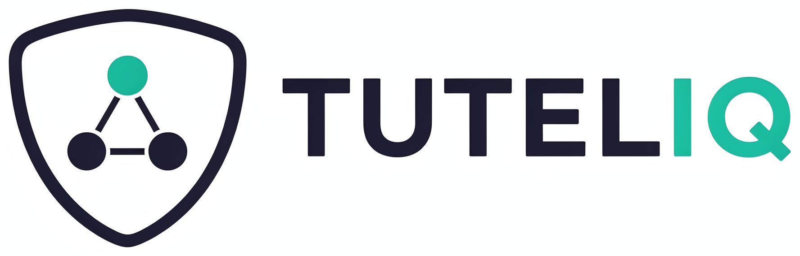

<p align="center">
  
</p>

<h1 align="center">Tuteliq Safety for Roblox</h1>

<p align="center">
  AI-powered child safety moderation for Roblox experiences.<br/>
  Detects grooming, bullying, and unsafe content in real-time chat.
</p>

<p align="center">
  <a href="https://github.com/Tuteliq/roblox-sdk/releases/latest"></a>
  <a href="LICENSE"></a>
  <a href="https://docs.tuteliq.ai/integrations/roblox"></a>
</p>

---

## Why Tuteliq?

Roblox's default chat filter catches profanity, but **grooming, manipulation, and social engineering bypass word filters entirely**. Tuteliq uses AI to understand *intent and context*, detecting:

- **Grooming & predatory behavior**: trust-building, isolation tactics, boundary testing
- **Bullying & harassment**: targeted abuse, exclusion, intimidation, including bullying a player reports
- **Unsafe content**: self-harm and distress, threats, requests to move off-platform, personal info solicitation

All processing runs server-side. No client mods, no data leaves Roblox except via your secure API key.

## Quick Start

1. Download `TuteliqSafety.rbxm` from the [latest release](https://github.com/Tuteliq/roblox-sdk/releases/latest)
2. In Roblox Studio, right-click `ServerScriptService` > **Insert from File**
3. Select the downloaded `.rbxm` file
4. Create a server script:

```lua
local TuteliqSafety = require(script.Parent.TuteliqSafety)

TuteliqSafety.start({
    apiKey = "tq_live_YOUR_API_KEY_HERE",
    sensitivity = "medium",
    detect = { "bullying", "grooming", "unsafe" },
})
```

That's it: Tuteliq monitors all chat messages automatically. A full example is in [`examples/TuteliqSafetyLoader.server.luau`](examples/TuteliqSafetyLoader.server.luau).

## Installation

### Roblox Model File (.rbxm)

1. Download `TuteliqSafety.rbxm` from the [latest release](https://github.com/Tuteliq/roblox-sdk/releases/latest)
2. In Roblox Studio, right-click `ServerScriptService` > **Insert from File**
3. Select the downloaded `.rbxm` file

### Creator Store

Search for **Tuteliq Safety** in the [Roblox Creator Store](https://create.roblox.com/store) and add it to your inventory.

### From source (Rojo)

The module source is in [`src/TuteliqSafety`](src/TuteliqSafety). Build a model file with [Rojo](https://rojo.space):

```sh
rojo build default.project.json -o TuteliqSafety.rbxm
```

## Configuration

| Option | Type | Default | Description |
|--------|------|---------|-------------|
| `apiKey` | string | *required* | Your Tuteliq API key |
| `sensitivity` | string | `"medium"` | Which detections are reported: `low`, `medium`, `high`, `maximum` (see below) |
| `detect` | table | all | Categories to detect: `"bullying"`, `"grooming"`, `"unsafe"` |
| `actions.mute` | boolean | `true` | Mute a player who is harming others when the recommended action is `block` or stronger |
| `actions.kick` | boolean | `false` | Kick a player who is harming others when the recommended action is `immediate_intervention` |
| `actions.notifyAdmins` | boolean | `true` | Fire the `TuteliqAlert` BindableEvent for every reported detection |
| `actions.log` | boolean | `true` | Log detections to output |
| `muteDurationSeconds` | number | `60` | Mute duration in seconds |
| `webhookUrl` | string | `nil` | Webhook URL for external alerts |
| `getPlayerAge` | function | `nil` | `function(player): number?` returning a player's age when your game knows it |
| `batchSize` | number | `25` | Items sent per batch request (1 to 50) |
| `batchFlushIntervalSeconds` | number | `5` | Longest wait before a batch is sent |
| `httpBudgetPerMinute` | number | `400` | Most API requests the module makes per minute |

### Sensitivity

Every result carries a `recommended_action`: `none`, `monitor`, `flag_for_review`, `block` or `immediate_intervention`. Sensitivity sets the weakest action that is reported:

| Sensitivity | Reports |
|-------------|---------|
| `low` | `block` and `immediate_intervention` |
| `medium` | `flag_for_review` and stronger |
| `high` | `monitor` and stronger |
| `maximum` | `monitor` and stronger, plus any detected signal |

### Who is muted or kicked

Mute and kick only ever apply to a player who is harming someone else. When the speaker is the one who needs help (a player reporting bullying, a child in distress, a disclosure), the detection still reaches admins and the webhook with `needsSupport = true`, and nobody is muted. Treat those as a support route, not a moderation one.

Muting sets the `TuteliqMuted` attribute on the player for `muteDurationSeconds`. Your chat setup decides what a muted player can do, for example by checking the attribute in `TextChannel.ShouldDeliverCallback`.

### Player ages

Grooming is analysed as conversations between two players. When `getPlayerAge` returns ages, each player is sent as a child or an adult with their age, which makes the analysis more accurate and lets a grooming detection mute the adult it is attributed to. Without ages, a grooming detection alerts with both players in `participants` and mutes nobody.

```lua
TuteliqSafety.start({
    apiKey = "tq_live_YOUR_API_KEY_HERE",
    getPlayerAge = function(player)
        return player:GetAttribute("VerifiedAge") -- nil when unknown
    end,
})
```

## Listening for Detections

Build custom admin dashboards and alerts by subscribing to detection events:

```lua
local alertEvent = TuteliqSafety.onDetection()
alertEvent.Event:Connect(function(data)
    -- data.type, data.recommendedAction, data.severity, data.confidence, data.riskScore
    -- data.rationale, data.needsSupport, data.participants (grooming)
    -- data.playerName, data.playerId, data.message, data.timestamp
    print(("[ALERT] %s | %s | %s"):format(data.type, data.recommendedAction, data.playerName or "conversation"))
end)
```

## How It Works

1. **Chat listener** hooks into `Player.Chatted` for every player
2. **Batch queue** sends every message for bullying and unsafe-content analysis, keeping track of who sent it
3. **Conversation buffer** pairs each player with the players they talk to (whispers separately) for grooming analysis
4. **AI analysis** detects harmful intent and context, not keywords
5. **Action dispatcher** alerts admins and your webhook, and mutes or kicks only a player harming others
6. **Rate limits** are respected: when the API asks the module to wait, messages are held and sent later rather than dropped

## Languages

Analysis supports 32 languages: English (stable) and Spanish, Portuguese, Ukrainian, Swedish, Norwegian, Danish, Finnish, German, French, Dutch, Polish, Italian, Turkish, Romanian, Greek, Czech, Hungarian, Bulgarian, Croatian, Slovak, Lithuanian, Latvian, Estonian, Slovenian, Maltese, Irish, Chinese, Japanese, Korean, Arabic and Russian (beta).

## Development

Tests run under [Lune](https://lune-org.github.io/docs) with stubbed Roblox services, so they need no network and no Roblox Studio. Lint uses [selene](https://kampfkarren.github.io/selene/).

```sh
lune run tests/run
selene src examples tests
```

## Documentation

Full documentation, integration guides, and API reference:

**[docs.tuteliq.ai/integrations/roblox](https://docs.tuteliq.ai/integrations/roblox)**

## Get an API Key

Sign up at **[tuteliq.ai](https://tuteliq.ai)** to get your API key. Free tier available for development and testing.

## Support

- **Documentation**: [docs.tuteliq.ai](https://docs.tuteliq.ai)
- **Email**: [support@tuteliq.ai](mailto:support@tuteliq.ai)
- **Issues**: [GitHub Issues](https://github.com/Tuteliq/roblox-sdk/issues)

## License

[MIT](LICENSE): free for commercial and personal use.
